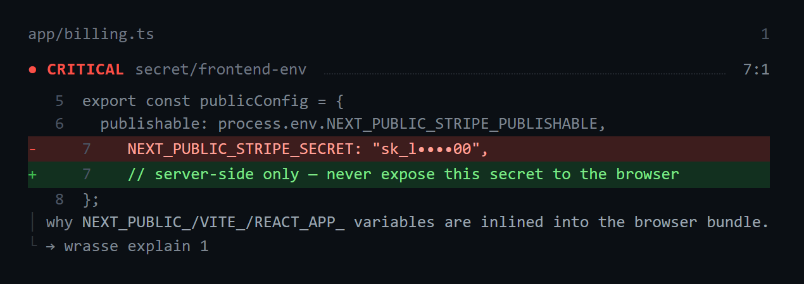

# wrasse

**Audit the code an AI wrote. Every finding comes with the exact line to replace.**

Deterministic rules, no model, no network by default, no API key.

**English** · [简体中文](README_zh.md)

**Version:** 1.0.0 · **License:** MIT · **Python:** 3.11+ · **Dependencies:** none

---

## What it does

It answers two questions.

**Will this code leak something?** Hard-coded keys, secrets in `NEXT_PUBLIC_*` variables, tokens in logs, stack traces returned to clients, secret fields in response models, upload paths built from filenames, a `.env` an agent can read.

**What did the AI leave out?** Packages that do not exist, routes with no authentication, queries with no ownership check, a check that only runs inside one role branch, request bodies without a schema, an input model the caller can set `is_admin` on, debug mode, wildcard CORS, unsafe deserialization, SQL built from values, an outbound call with no timeout, request text written straight into a log line, a broken cipher, invisible characters planted in an agent instruction file, a template built from the request, an admin path that only checks login, a list endpoint with no ceiling, a verification that returns True when it throws.

Every finding carries the file, the line, the source text and the reason. The red line is what you have; the green line is what to put there. Where a correct generic replacement cannot be proven, the green line says so and does not invent one: a wrong patch makes the problem look fixed.

62 rules. 268 tests. Nothing calls a model.

## What a finding looks like



A `?` before the rule id means `needs_review`: reported, but never counted by `--fail-on`.

## Install

```bash
pip install wrasse
```

```bash
wrasse --version
```

There are no dependencies. From a checkout, `python -m pip install -e . --no-deps` or `PYTHONPATH=src python -m wrasse …` runs the same code.

The npm package `wrasse-audit` (`npm/` in this repo) is a launcher only: it runs the Python copy you already have and exits 127 when there is none.

Java: `Cipher.getInstance("DES…")` and `MessageDigest.getInstance("MD5")` are checked without installing anything extra. The three Spring rules need a parser rather than a JDK: `pip install wrasse[java]` adds wildcard `@CrossOrigin`, `.csrf().disable()` and `permitAll()`.

## Use

Day to day:

```bash
wrasse
```
Start the session: the last scan, then a prompt.

```bash
wrasse audit .
```
Scan the current project.

```bash
wrasse review
```
Step through the findings.

```bash
wrasse explain 3
```
Why the third one is a finding.

```bash
wrasse open 3
```
Open it at its line.

```bash
wrasse config set lang zh
```
Report language, saved for this project.

Wiring it in:

```bash
wrasse audit . --diff main
```
Only lines changed since main.

```bash
wrasse audit . --mode quick
```
L1 only, fast enough for a pre-commit hook.

```bash
wrasse audit . --format sarif --fail-on high
```
CI and code scanning.

```bash
wrasse audit . --online --history
```
Registry checks and deleted keys.

```bash
wrasse baseline create
```
Freeze what you already have.

```bash
wrasse preflight .
```
Before letting an agent open a repo.

Every command and flag: [docs/commands.md](docs/commands.md). Inside the session a full command works too (`audit . --focus privacy`), plus `/audit`, `o 3`, `?` and `q`. Typing `/` opens a command menu (`Tab` completes, `↑↓` moves); `/config` opens the settings panel.

## Two mainlines, two depths

`--focus privacy | ai | all` picks what to report. `--mode quick | standard` picks how deep to scan. They are independent: the same finding keeps the same id, severity and evidence under any combination.

`quick` is L1 only, fast enough for a pre-commit hook. `standard` adds data flow and the structural authorization checks.

## Exit codes

| Code | Meaning |
|---|---|
| `0` | nothing at or above `--fail-on` |
| `2` | a finding reached `--fail-on` (default `high`) |
| `3` | the path is not a project |
| `4` | **the scan did not finish**, which is not a pass |

## What it guarantees

Every item below has a test.

- It parses the project without importing or running it.
- It never calls a model, and `core`/`facts`/`structure` cannot import one.
- A credential is masked before any renderer sees it: terminal, JSON, SARIF, HTML, state file.
- It reads only regular files inside the project, and writes only `.wrasse/` inside it.
- Offline by default. `--online` is the only thing that leaves the machine, and it says so when it does.

## Limits

- Authorization is structural: "never written" and "written for one role" are caught; a rule spread across services is `needs_review`.
- `+` marks a verified replacement, `~` a template to adapt, `!` a finding with no automatic fix. Read a `~` line before pasting it.
- Python and FastAPI in depth. Java: two line-level rules built in, three more with `wrasse[java]`. `include_router` prefixes and app-level dependencies are inherited across files when the mount is static.
- A file over 2 MB is not read: it is named in the warning, the result is marked
  incomplete and the command exits `4`. A scan also stops at 20,000 files or 256 MB
  (exit `4`). No incremental scan yet.
- XSS is covered for templates (`|safe`), DOM sinks (`innerHTML`) and HTML responses; a
  custom renderer is not. An escaper is judged by the function, not by whether the value
  lands in a text node or an attribute.
- Data flow crosses one function boundary; a second helper in between is not followed.
- SSRF is judged where the URL is built. A request that is allowed and then redirects
  somewhere else is not followed.
- MCP runtime poisoning is not covered.

## Docs

- **[examples/showcase-report.html](examples/showcase-report.html)**: every rule on one page, generated from `examples/showcase/`
- **[docs/commands.md](docs/commands.md)**: which command for which job, for daily use and for wiring it into CI
- **[docs/reading.html](docs/reading.html)**: how to read a report, every number and symbol
- **[docs/rules.html](docs/rules.html)**: every rule with its reason and replacement
- [docs/architecture.md](docs/architecture.md): layers, data model, command surface
- [CONTRIBUTING.md](CONTRIBUTING.md): how to add a rule, and what a fix must prove
- [SECURITY.md](SECURITY.md): how to report a problem in wrasse itself

## Tests

```bash
python -m unittest discover -s tests
```

268 tests, no network. `tests/corpus/vulnerable/` holds 53 planted rule/file pairs (62 findings) that must all be found; `tests/corpus/secure/` holds 16 samples that look wrong and are not.

## License

MIT. Author and maintainer: Jiaming Shi.
