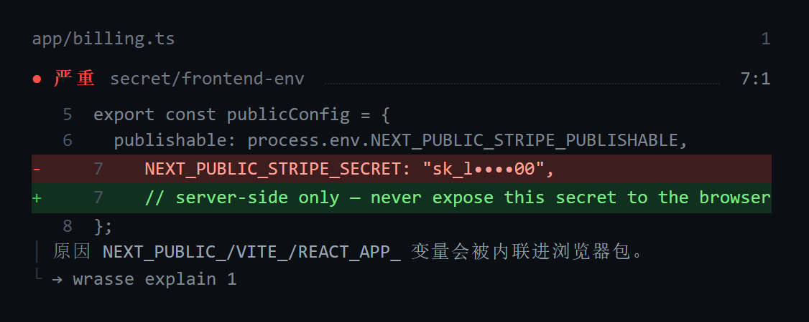

# wrasse

**审计 AI 写的代码。每条结论都附上可以直接替换的那一行。**

确定性规则，不调模型，默认不联网，不需要 API key。

[English](README.md) · **简体中文**

**版本：** 1.0.0-beta · **许可：** MIT · **Python：** 3.11+ · **依赖：** 无

---

## 它做什么

它只回答两个问题。

**这段代码会不会把东西漏出去？** 硬编码密钥、写进 `NEXT_PUBLIC_*` 的密钥、打进日志的 token、返回给客户端的异常原文、响应模型里的密码字段、用上传文件名拼的路径、Agent 能读到的 `.env`。

**AI 少写了什么？** 不存在的依赖包、没有认证的路由、没有归属校验的查询、只在一个角色分支里做的归属校验、没有 schema 的请求体、调用方能在请求模型里设 `is_admin`、调试模式、通配 CORS、不安全的反序列化、用值拼出来的 SQL、没设超时的出站请求、请求原文直接进日志、已被攻破的加密算法、藏在 Agent 指令文件里的不可见字符、拿请求当模板、只校验登录的管理端路径、没有上限的列表接口、抛异常就放行的校验。

每条 finding 带文件、行号、源码原文和原因。红行是现有代码，绿行是替换写法。一条通用修复如果无法证明正确，绿行直接说明，不给出猜测的版本：错补丁一旦被采纳，问题看起来就解决了。

62 条规则，185 个测试，没有一处调用模型。

## 安装

beta 属于预发布版本，1.0.0 正式发布前 pip 需要加 `--pre`。

```bash
pip install --pre wrasse
wrasse --version
```

没有任何依赖。从源码用：`python -m pip install -e . --no-deps`，或者直接 `PYTHONPATH=src python -m wrasse …`，跑的是同一份代码。

npm 上的 `wrasse-audit`（源码在 `npm/` 目录）只是一个启动器：调用你本机已装的那份 Python 程序，没装就以退出码 127 提示 pip 命令。

Java 的两条规则（`Cipher.getInstance("DES…")`、`MessageDigest.getInstance("MD5")`）不需要额外安装。Spring 的三条需要解析器，但不需要 JDK：`pip install wrasse[java]` 之后多出三条规则，管 `@CrossOrigin` 通配、`.csrf().disable()` 和 `permitAll()`。

## 使用

日常够用的四条：

```bash
wrasse              # 进会话：上次扫描 + 提示符
wrasse audit .      # 扫描当前项目
wrasse review       # 逐条过
wrasse explain 3    # 第 3 条为什么成立
wrasse open 3       # 打开第 3 条所在的行
wrasse config set lang zh  # 报告语言，存进这个项目
```

要接进流程时：

```bash
wrasse audit . --diff main                     # 只看 main 之后改动的行
wrasse audit . --mode quick                    # 只跑 L1，适合挂 pre-commit
wrasse audit . --format sarif --fail-on high   # CI 与代码扫描
wrasse audit . --online --history              # 注册表核对 + 已删除的密钥
wrasse baseline create                         # 冻结存量，之后只看新增
wrasse preflight .                             # 把仓库交给 Agent 之前
```

全部命令与参数见 [docs/commands.md](docs/commands.md)。会话里也能直接敲完整命令（`audit . --focus privacy`），以及简写 `/audit`、`o 3`、`?`、`q`。敲 `/` 弹出命令菜单（`Tab` 补全、`↑↓` 选择），`/config` 打开设置面板。

## 一条 finding 长什么样



规则 id 前面的 `?` 表示 `needs_review`：会报出来，但不计入 `--fail-on`。

## 两条主线，两种深度

`--focus privacy | ai | all` 决定报哪条线；`--mode quick | standard` 决定扫多深。两者独立：同一条 finding 在任何组合下 id、严重度、证据都不变。

`quick` 只跑 L1，速度快，适合挂在提交前。`standard` 再加数据流和结构性授权检查。

## 退出码

| 码 | 含义 |
|---|---|
| `0` | 没有达到 `--fail-on` 的问题 |
| `2` | 有 finding 达到阈值（默认 `high`） |
| `3` | 路径不是可扫描的项目 |
| `4` | **扫描没跑完**，不能当作通过 |

## 它对自身的保证

下面每一条都有对应的测试。

- 不 import、不运行被扫项目，只做解析。
- 不调模型，`core` / `facts` / `structure` 里禁止出现模型客户端。
- 密钥在交给任何渲染器之前脱敏：终端、JSON、SARIF、HTML、状态文件都一样。
- 只读项目内的普通文件，只写项目内的 `.wrasse/`。
- 默认离线。`--online` 是唯一会让数据离开本机的东西，运行时它会说明查了哪些包。

## 边界

- 授权分析是结构性的：能抓"完全没写"和"只对一个角色写了"，跨服务的业务规则一律 `needs_review`。
- 绿行前有标记：`+` 是已验证的替换，`~` 是模板（按你的变量名和导入改），`!` 表示没有自动修复。`~` 行粘贴前先读一遍。
- Python / FastAPI 做深；Java 内置两条按行判断的规则，装 `wrasse[java]` 后多三条。`include_router` 的前缀与应用级依赖在静态挂载时跨文件继承。
- 单个文件超过 2 MB 不会被扫描：会点名、标记结果不完整并返回退出码 `4`。整体上限 2 万文件 / 256 MB，超出同样是 `4`。暂时没有增量扫描。
- XSS 覆盖模板 `|safe`、DOM 的 `innerHTML`、HTML 响应三种；自定义渲染器不覆盖，也不区分转义结果落在文本节点还是属性里。
- 数据流只跨一层函数，中间再套一层 helper 不追。
- SSRF 只看 URL 是怎么拼出来的；请求发出后跳转到别处不追踪。
- 不覆盖 MCP 运行时投毒。

## 文档

- **[examples/showcase-report.html](examples/showcase-report.html)**：每条规则在真实扫描结果里长什么样，一页看完
- **[docs/commands.md](docs/commands.md)**：哪个场景用哪条命令，日常用法与接入 CI
- **[docs/reading.html](docs/reading.html)**：怎么看报告，每个数字、每个符号
- **[docs/rules_zh.html](docs/rules_zh.html)**：每条规则的原因与替换写法（中文）
- [docs/architecture.md](docs/architecture.md)：分层、数据模型、命令面
- [CONTRIBUTING.md](CONTRIBUTING.md)：怎么加一条规则，以及一条修复必须证明什么
- [SECURITY.md](SECURITY.md)：wrasse 自身的安全问题怎么报

## 测试

```bash
python -m unittest discover -s tests
```

185 个测试，全程离线。`tests/corpus/vulnerable/` 里 53 组埋点（62 条 finding）必须全部找到；`tests/corpus/secure/` 里 16 个"看着有问题其实没问题"的样本必须保持干净。

## 许可

MIT。作者与维护者：Jiaming Shi。
